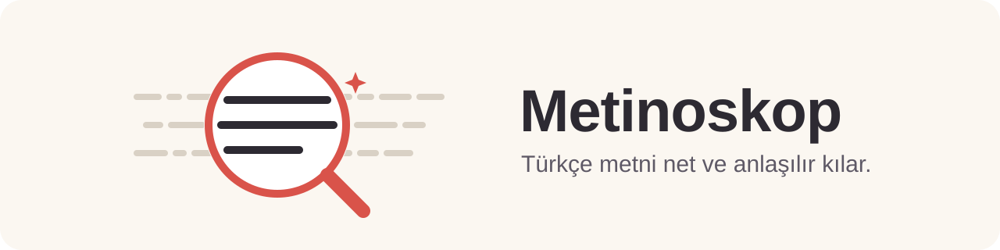

<p align="center"></p>

# Metinoskop

[](https://github.com/ayberkdt/metinoskop/actions/workflows/validate.yml)
[](LICENSE)


Türkçe metni net ve anlaşılır kılan taşınabilir bir agent skill paketi: her önerme bir kez, doğru yerde ve kaynağın kesinliğiyle söylenir.

Omurgası, havacılık belgeleri için geliştirilmiş ASD-STE100 (Simplified Technical English) standardının yazım ilkelerinden Türkçeye uyarlanmıştır: bir paragraf bir konu, kısa ve doğrudan cümle, bir terim bir anlam; şişirme, döngüsel anlatım ve aynı konuyu yeniden açma yok. Öncelikli alan bilimsel ve teknik metindir, ilkeler her konuda geçerlidir.

Metinoskop bir sözcük yasaklama listesi değildir. Metni sırf farklı görünsün diye yeniden yazmaz: anlamı, olguları, kesinlik düzeyini ve yazarın tavrını koruyarak yalnızca gerekçesi olan müdahaleyi yapar. Netlik hiçbir zaman kesinliğin önüne geçmez. Metin zaten iyiyse olduğu gibi bırakır.

Kullanmak için metni verip "Bu metni geliştir" demeniz yeterli; düzeyi, kapsamı ve neyin düzeltileceğini Metinoskop kendisi belirler ([Kullanım](#kullanım)).

## Bir bakışta

`evals/dongusel-tanim.md`

| Önce | Sonra |
|---|---|
| **Kalibrasyon, ölçüm sisteminin kalibre edilmesi işlemidir.** | *— silindi* |
| Bu çalışmada kuvvet sensörü 12 referans ağırlıkla kalibre edildi **ve** doğrusallık hatası %0,8'den %0,2'ye indi. | Bu çalışmada kuvvet sensörü 12 referans ağırlıkla kalibre edildi**;** doğrusallık hatası %0,8'den %0,2'ye indi. |
| **Başka bir deyişle, kalibrasyondan sonra sensörün doğrusallık hatası azaldı.** | *— silindi* |
| **Bu sonuç, kalibrasyonun ölçüm doğruluğu açısından kritik önemini açıkça ortaya koymaktadır.** | *— silindi* |
| **Sonuç olarak, kalibrasyon sensörün doğrusallık hatasını düşürmektedir.** | *— silindi* |

Beş cümlede tek bir ölçüm vardı. Birinci cümle terimi kendisiyle tanımlıyordu. Son üç cümle aynı ölçümü açımlama, önem ve mini sonuç olarak üç kez daha söylüyordu; sonuncusu da tek bir ölçümü genel bir yasaya çeviriyordu. Kalan cümlede sayıların hepsi duruyor.

## Örnekler

Aşağıdaki çiftler depodan alınmıştır. Dosya adı verilenler `evals/outputs/` altında kayıtlı birer sözleşmedir; ikisi `SKILL.md` içindeki kısa örneklerdir. Kalın yazılan yerler değişen kısımlardır.

### Aynı olguyu dört kez söylemek

`evals/iddia-tekrar-dongusu.md`

| Önce | Sonra |
|---|---|
| Polinom derecesi 20 ile 200 arasında değiştirildiğinde en düşük doğrulama hatası 120. derecede elde edilmiştir (%2,1). | Polinom derecesi 20 ile 200 arasında değiştirildiğinde en düşük doğrulama hatası 120. derecede elde edilmiştir (%2,1). |
| **Başka bir ifadeyle 120. derece, denenen diğer derecelerden daha başarılı olmuştur.** | *— silindi* |
| **Bu sonuç, derece seçiminin model başarımı açısından kritik önemini açıkça ortaya koymaktadır.** | *— silindi* |
| **Dolayısıyla uygun derecenin seçilmesi, başarım açısından belirleyici bir etkendir.** | *— silindi* |
| 200. derecede hata %6,8'e yükselmiştir. | 200. derecede hata %6,8'e yükselmiştir. |

Beş cümlenin üçü hiçbir yeni önerme taşımıyordu: ikincisi ilkini başka sözcüklerle tekrarlıyor, üçüncüsü ondan genel bir önem çıkarıyor, dördüncüsü o önemi bir kez daha söylüyordu. İki ölçüm dokunulmadan duruyor.

### Yapılmış işi kılavuz gibi anlatmak

`evals/raporda-genis-zaman-yigini.md`

| Önce | Sonra |
|---|---|
| **Bu çalışmada** 12 Ağustos'ta toplanan 1.200 kayıt incele**nir**. | 12 Ağustos'ta toplanan 1.200 kayıt incele**ndi**. |
| Çalışma üç veri kümesi**ni kullanır**. Her kümeye aynı filtre uygula**nır** ve sonuçlar karşılaştırıl**ır**. | Üç veri kümesi **kullanıldı**; her kümeye aynı filtre uygula**ndı** ve sonuçlar karşılaştırıl**dı**. |
| Ortalama hata %4 olarak hesapla**nır**. | Ortalama hata %4 olarak hesapla**ndı**. |
| Yalnızca düşük yoğunluklu bölgelerde hata %6'ya **çıkar**. | Yalnızca düşük yoğunluklu bölgelerde hata %6'ya **çıktı**. |

Tarih ve ölçümler bir kez olup bitmiş işi bildiriyor, yüklemler ise genel prosedür anlatıyordu. Bu çelişkinin adı *zamansal sürtünme*. Metinoskop metnin baskın zaman çizgisini bulup ona göre çözüyor. `Yalnızca` kapsam işareti yerinde kalır.

### İngilizce iskeletini Türkçe sözcüklerle taşımak

`evals/sahip-olmak-kalkisi.md`

| Önce | Sonra |
|---|---|
| Önerilen yöntem yüksek bir hesaplama maliyeti**ne sahiptir**. | Önerilen yöntem**in** hesaplama maliyeti **yüksektir**. |
| Model üç katman**a sahiptir** ve her katman 64 birim**e sahiptir**. | Model üç katman**lıdır**; her katman**da** 64 birim **bulunur**. |
| Cihaz IP67 koruma sınıfı**na sahiptir**. | Cihaz**ın** koruma sınıfı **IP67'dir**. |
| Sistem ayrıca bir hata günlüğü**ne sahiptir**. | Sistem ayrıca hata günlüğü **tutar**. |

Dört cümlenin dördü de İngilizce `have` iskeletini taşıyordu. Sözcükler yeniden çevrilmiyor; ilişki Türkçenin iyelik, sıfat ve yüklem kaynaklarıyla yeniden kuruluyor. Aynı vakada gerçek mülkiyet bildiren `şirketin sahip olduğu iki fabrika` ile yükümlülük bildiren `yönetici yetkisine sahip olmalıdır` olduğu gibi kalır: kalıp aynı, işlev farklı.

### Fiili adın arkasına saklamak

`evals/hafif-fiil-sismesi.md`

| Önce | Sonra |
|---|---|
| Ekip, veri kümesi üzerinde bir **değerlendirme gerçekleştirmiştir**. Ardından 3 model üzerinde **analiz gerçekleştirilmiş** ve sonuçların **karşılaştırılması işlemi yapılmıştır**. | Ekip veri kümesini **değerlendirmiş**, ardından 3 modeli **analiz edip** sonuçları **karşılaştırmıştır**. |
| **En iyi model için iyileştirme sağlanmış ve** hata %9'dan %6'ya düşürülmüştür. | **En iyi modelde** hata %9'dan %6'ya düşürülmüştür. |

`Değerlendirme gerçekleştirmek` üç sözcükte bir fiil taşıyordu. Ölçümler ve aktör aynı; yalnızca yüklem gerçek yüklem oldu.

### Her kavrama başlık açmak

Aşağıdaki dönüşüm derin düzenleme ister; standart düzeyde başlıklar korunur.

**Önce**

> ### Örnekleme stratejisinin seçimi
>
> Model eğitiminde katmanlı örnekleme kullanılmıştır.
>
> ### Örnekleme stratejisinin önemi
>
> Örnekleme stratejisi hata oranı açısından belirleyici bir rol oynamaktadır. Ancak asıl etki bir sonraki bölümde görülecektir.
>
> ### Düşük yoğunluklu bölgelerdeki etki
>
> Yukarıda belirtilen katmanlı örnekleme, düşük yoğunluklu bölgelerde hata oranını %9'dan %4'e düşürmüştür.

**Sonra**

> ### Örnekleme stratejisi
>
> Model eğitiminde katmanlı örnekleme kullanılmıştır; bu örnekleme, düşük yoğunluklu bölgelerde hata oranını %9'dan %4'e düşürmüştür.

Üç başlık tek kavramsal birimdi. Yöntem bilgisi ve iki ölçüm duruyor; giden şey bölünmenin kendi ürettiği dolgu: `belirleyici rol` nitelemesi, `bir sonraki bölümde görülecektir` askısı ve `yukarıda belirtilen` göndermesi. Bölünme olmasa bu üç ifadeye gerek olmazdı.

### Geçmişin kendi içindeki üç ilişki

`references/zamansal-ankraj-ve-rapor-kipi.md`

Bir olay raporunda baskın çizgi yalın geçmiştir, ama her cümle o çizgide durmaz:

> 14 Mayıs testinde basınç düşerken pompa hâlâ **çalışıyordu**. Operatör alarmı 03.12'de **fark etti** ve ana vanayı **kapattı**. Vana kapandığında yedek hat çoktan devreden **çıkmıştı**.

Üç kip üç ayrı ilişki taşır: artalan, ana olay dizisi, daha önce tamamlanmış olay. Hepsini `-dı` yapmak bilgi kaybettirir — pompanın çalışması sınırlı bir olaya döner, yedek hattın önceden çıkmış olması ise vananın kapanmasıyla eş zamanlı görünür. Metinoskop bu ilişkileri korur; kaynak kurmuyorsa da uydurmaz.

### Hiç dokunulmayan metin

`evals/iyi-metin.md`

> Merhaba Selin, Mart raporunun taslağını ekte gönderiyorum. Üç bölgenin satış rakamları tamam; yalnızca Ege bölgesinin iade verisi henüz gelmedi, o sütunu boş bıraktım. Muhasebe verinin çarşamba öğleden önce geleceğini söyledi. Rapor, geçen ay konuştuğumuz gibi bayi bazında değil bölge bazında hazırlandı; bayi kırılımı istersen ayrı bir sayfa ekleyebilirim. Perşembe sabahına kadar yorumlarını bekliyorum. Ayşe

Bu vakanın kayıtlı çıktısı kaynağın kendisidir. Doğru davranış hiçbir şeyi değiştirmemektir; doğrulayıcı bu eşitliği denetliyor.

## Neyi değiştirmemekte ısrar eder

Bir metin düzenleyicisini asıl zor kılan, ne zaman duracağını bilmesidir. Yüz seksen sekiz eval vakasının altmış birinde beklenen çıktı kaynağın kendisidir:

| Metinde geçen | Neden dokunulmaz |
|---|---|
| `RK4 her adımda türevi dört kez değerlendirir.` | Algoritmanın genel davranışı. Makalede geçiyor diye geçmişe çevrilmez. |
| `Sıcaklık yükseldikçe direnç artar.` | Genel bilimsel ilişki. Geçmişe çevrilirse tek seferlik gözleme iner. |
| `Bakımdan önce şalter kapatılır ve hattaki basınç boşaltılır.` | Yeniden kullanılabilir prosedür; üstelik güvenlik adımı. |
| `Filtre ölçümü 50 Hz'de alır. Gözlemci durumu günceller.` | İki ayrı aktör var; özne düşürmek göndergeyi belirsizleştirir. |
| `Kalman kazancının hesaplanması, yenilik kovaryansının tersinin alınmasını gerektirir.` | Teknik işlemi adlandıran yapı; dolgu değil, terimin kendisi. |
| `... iade etmeyi kabul ve taahhüt eder.` | Hukuki formül. "Doğallaştırmak" hukuki etkiyi değiştirir. |
| `Model, baseline ile aynı pipeline üzerinde üç benchmark'ta değerlendirildi.` | Yerleşik ödünç terimler; öz Türkçe hevesiyle değiştirilmez. |
| `Bu veri kümesinde etki gözlenmedi.` | Kanıt yokluğu, yokluğun kanıtı değildir; `etki yoktur` olmaz. |
| `Güneşsiz bir günde panel çıkışı 40 W'a düştü.` | İçinde `eşsiz` dizisi geçiyor diye pazarlama dili sayılmaz. |
| `... çalışma gözlemsel olduğundan nedensellik göstermemektedir.` | Kanıt düzeyi bildiren çekince, "AI gibi" diye silinmez. |
| `Başvurular her yıl 15 Ekim'de kapanır.` | Açık tarih + geniş zaman her zaman hata değildir; bu yinelenen bir takvim kuralı. |
| `Basınç düşerken pompa hâlâ çalışıyordu.` | Artalandaki süren eylem; `çalıştı` bunu sınırlı bir olaya çevirir. |
| `Hesaplamalar eylemsiz referans çerçevesinde yapıldı.` | Fizik terimi; `frame` çevirisi olduğu için bozulmaz. |
| `Uçuş test kampanyası 14 sortiden oluştu.` | Havacılığın kendi terimi; `campaign` kalkısı sanılmaz. |
| `Denetleyici belleği sayfalar hâlinde adresler.` | `Address` burada gerçek teknik anlamdır. |
| `Sistem yetkili kullanıcılara erişim sağlıyor.` | `Erişim sağlamak` yerleşik eşdizim; `provide` kalkısı değil. |
| `Model yüksek frekanslı davranışı iyi yakalıyor.` | Modelleme grubunun kendi terminolojisi. |
| `Yönetmelik kişisel verilerin izinsiz aktarılmasını yasaklar.` | Kuralın normatif içeriği; işleyen bir sistemin bugünkü davranışı değil. |
| `Bu tür sonuçlar dikkatli inceleme gerektirir.` | Bir sonuç sınıfı hakkında; `bu sonuç ... gerektiriyor` ile karıştırılmaz. |

Her satır bir eval vakasına dayanır ve kayıtlı çıktısı kaynağın kendisidir.

## Ne yapar?

**Netlik omurgası.** Yedi kural, ASD-STE100'ün yazım ilkelerinden uyarlanmıştır: (1) bir paragraf bir konu taşır, dağılmış konu tek yerde toplanır; (2) her önerme bir kez söylenir, döngüsel tanım ve açımlama döngüsü kalkar; (3) yalnızca gerekli bilgi yazılır; (4) cümle kısa ve doğrudandır, ilgisiz önermeler tek cümleye yığılmaz, talimatta cümle başına bir adım vardır; (5) bir kavramın tek adı olur; (6) aktör biliniyorsa somut özne ve somut yüklem kullanılır; (7) yapı okura hizmet eder. STE'nin sayısal eşikleri (betimleyici cümlede 25 sözcük, paragrafta altı cümle) inceleme işaretidir, kesme kuralı değildir: tek bir ilişkiyi taşıyan uzun cümle korunur. STE'nin İngilizceye özgü sözlüğü ve fiil kısıtları alınmamıştır. Ayrıntı ve STE eşleme tablosu: [`references/netlik-omurgasi.md`](references/netlik-omurgasi.md).

**Bütüncül düzenleme.** Tek başına kusursuz bir cümle, paragrafında yanlış yerde durabilir. Metinoskop metni cümle cümle değil, belge, paragraf, cümle ve sözcük katmanlarını birlikte düşünerek düzenler: önce yukarıdan aşağı teşhis eder, her düzeltmeden sonra bir üst katmanı yeniden okur. Her paragrafta cümlelerin rolünü (iddia, kanıt, yorum, sınırlılık) ve sırasını sınar; doğru ama yanlış yerde duran cümleyi yeniden yazmaz, ait olduğu yere taşır.

**Türkçenin bağlayıcı kaynakları.** İlişkileri yalnızca `Ayrıca`, `Ancak`, `Bu nedenle` gibi cümle başı etiketlerle değil, Türkçenin eklerle ve ilgeçlerle kurduğu kaynaklarla kurar: `-e rağmen`, `-mesine karşın`, `olmasının yanında`, `-mesinin yanı sıra`, `-den/-dan`, `-dığından`, `sayesinde`, `ise`, `-ken`, `-erek`, `-e kıyasla`, `merceğinden`. Bağlayıcı yalnızca kaynağın kurduğu ilişkiyi kodlar: `sayesinde` ile nedensellik uydurmaz. Aynı paragrafta peş peşe gelen aynı bağlacı, genel fiili (`göstermek`, `sağlamak`) ya da değerlendirme sıfatını giderir; terimi ise sabit tutar. Katalog: [`references/turkce-baglayicilar.md`](references/turkce-baglayicilar.md).

**Kalıp ve ritim.** Mekanik cümle ritmini, tekrarlanan kalıpları, gereksiz `-maktadır/-mektedir` zincirlerini ve `gerçekleştirilmesi`, `sağlanması` gibi ad zincirlerini sadeleştirir. Kurumsal dolguyu, reklam dilini ve tiyatral vurguyu azaltır.

**Bilgi taşımayan cümleler.** Bir cümleyi silince hiçbir olgu, ilişki ya da yazar görüşü kaybolmuyorsa o cümle *sıfır bilgi cümlesi*dir ve çıkar. Dayanaksız önem iddiaları, savunmacı açıklamalar, aynı olgunun başka sözcüklerle tekrarı, bölüm duyuruları, kalıp giriş ve sonuçlar, sırf ölçülü görünmek için kurulan karşıtlıklar bu sınıfa girer. Buna karşılık birkaç bulguyu tek karar cümlesinde toplayan cümleyi, adı konmuş sınırlılığı ve ölçülmüş yöntem gerekçesini korur. Çıkardığı dolguyu daha sakin eş anlamlılarla geri koymaz.

**Kenar türler.** Hukuki metin, tanıtım ve pazarlama, deneme, köşe yazısı ve sosyal medya, kişisel yazışma, edebî metin ve üslup eşleme için ek kurallar ayrı bir dosyada durur: [`references/kenar-turler.md`](references/kenar-turler.md). Ajan bu dosyayı yalnızca metin o türdense okur; hukuki kalıp, ikna amacı ya da yazara özgü imge gibi istisnalar bilimsel metne taşınmaz. Örneğin denemede görüş korunur ama `adeta bir pencere`, `bir keşif, bir dönüşüm, bir yolculuk` gibi her konuya yapışan ambalaj atılır.

**Yapı.** Hak edilmemiş başlıkları ve tek paragraflık bölümleri birleştirir, erken bölünmüş paragrafları toplar, sonucu sınırlılığıyla yan yana getirir, gereksiz derinliği düzleştirir. Bölüm sonuna asılan "asıl cevap sonraki bölümde" tipi kapanışları, her bölümde yinelenen bağlam hatırlatmalarını ve boş bölüm duyurularını kaldırır. Tekrarlanabilirlik, mevzuat, dergi kuralı, güvenlik adımları ve uzun belgelerde gezinme gerektiren yapıyı korur; hedef yazarın kendi ölçeğini aşan makine parçalanmasıdır, evrensel asgaricilik değil.

**Çeviri gibi okunan Türkçe.** Bir cümle dil bilgisi bakımından kusursuz olup yine de altında bir İngilizce cümle taşıyabilir: bilgi sırası, özne kullanımı ve yan cümle mimarisi oradan miras kalmıştır. Böyle bir metinde *çeviri kokusu* vardır. Metinoskop sözcükleri bir kez daha çevirmez; cümlenin taşıdığı ilişkiyi bulup Türkçenin kendi araçlarıyla (özneyi düşürme, ekler, sözcük sırası) yeniden kurar. Her cümlede yinelenen özneyi, `bu sonuç / bu durum` paketlerini, `ve` ile dizilmiş cümle zincirlerini, `sahip olmak` ve `bulunmaktadır` kalıplarını koku sayar. Gerekli açık özneyi, teknik terimi, hukuki kalıbı ve zaten Türkçe düşünülmüş metni olduğu gibi bırakır. Bazı kalkılar ise yalnızca doğal değildir, okura başka bir önerme verir: `bulgular ... olduğunu önermektedir` okura bir tavsiye gibi gelir, oysa kastedilen bir çıkarımdır (`düşündürüyor`). Bu tür anlam hataları hafif düzenlemede de düzeltilir; aynı sözcüklerin doğru kullanımı (`yeni bir yöntem önermektedir`, `sonuçlar tartışılmıştır`) korunur.

**Kim, neyi, ne kadar kesin biliyor.** Bir cümlenin olguları değişmeden de yanlışlaşabilir: kimin bildiği, nasıl bildiği ve ne kadar kesin iddia ettiği değişmişse cümle aynı cümle değildir. Metinoskop bunu düzenleme boyunca sabit tutar. Başkasının söylediğini yazarın olgusuna, ilişkiyi nedenselliğe, öneriyi karara, kararı uygulamaya çevirmez; `gözlenmedi` `yoktur` olmaz. Kaynağın adını vermediği bir aktörü uydurmaz. `Olabilir`, `görünmektedir` gibi çekinceleri kanıt sayıp korur, `açıkça`, `tartışmasız` gibi pekiştiricileri dayanağı yoksa kaldırır.

**Zaman ve kip.** Tamamlanmış bir çalışmayı `inceler / kullanır / uygular` gibi zamansız kiplerle anlatan metin, yapılmış bir işi kullanım kılavuzuna çevirir: *kılavuz kokusu*. Metinoskop yapılan işi olmuş bitmiş olay olarak anlatır. Buna karşılık algoritmanın genel davranışını, bilimsel bir ilişkiyi, ürün belirtimini ve prosedürü geniş zamanda bırakır; bunlar gerçekten zamansızdır. Tek bir gözlemi geniş zamana çevirip genel yasaya yükseltmez, genel bir ilişkiyi geçmişe çevirip tek seferlik olaya indirmez. Geçmişin kendi içindeki ilişkileri de düzleştirmez: `çalışıyordu` artalanı, `kalibre edilmişti` daha önce tamamlanmış olmayı, `yapardı` düzenli davranışı bildirir. Şimdiki zamanı da eksik bırakmaz: mevcut sistem davranışı, güncel durum, okurun önündeki belgenin işlevi ve o an tartışılan bulgunun yorumu doğal olarak `-yor` alabilir; `bu sonuç ... gerektiriyor` ile `bu tür sonuçlar ... gerektirir` aynı kapsamda değildir.

**Sözcüklerin birbirine tutunması.** Bir sözcük tek başına doğru olup birleşimde yanlış olabilir: `karar gerçekleştirmek`, `X hakkında odaklanmak`, `cevap sağlamak`. Metinoskop bu birleşimleri Türkçenin alışılmış eşleşmeleriyle kurar; `bir değerlendirme gerçekleştirmek` gibi yapıların arkasına saklanan gerçek fiili öne çıkarır. Aynı nesneyi `yöntem`, `yaklaşım`, `yapı`, `çözüm` arasında gezdirmez; teknik terimi, ödünç sözcüğü ve hukuki kalıbı korur. Sözcükler Türkçe olduğu hâlde birleşme tercihi İngilizceden taşınmışsa bunu da görür: `framework` her yerde `çerçeve`, `provide` her yerde `sağlamak`, `address` her yerde `adreslemek` olmaz. Ama karar alan jargonuna bakar — `referans çerçevesi`, `test kampanyası`, `belleği adreslemek` ve `hipotezi desteklemek` yerleşik terimlerdir, yabancı kökenli göründükleri için bozulmaz.

**Cümleler arası bağ.** İyi cümlelerden kurulu bir metin yine de bir düşünceyi geliştiremeyebilir. Her cümlenin öncekinden ne aldığına, `bu nedenle` gibi bağlaçların gerçekten kurduğu ilişkiyi taşıyıp taşımadığına, `bu / söz konusu` göndergesinin kaç cümle uzaktan geri bulunabildiğine, `yalnızca` ve olumsuzluğun doğru ögeye bağlı kalmasına, sınırlılığın sınırladığı iddianın yanında durmasına bakar. Zaman sırasını nedenselliğe çevirmez, eksik öncül uydurmaz.

**Ses ve biçim.** Verdiğiniz yazı örneğine göre ton eşleştirmesi yapar. Olumsuzluğu, sayıları, koşulları, istisnaları ve `yalnızca`, `en az`, `henüz` gibi kapsam sözcüklerini; teknik terimleri, sembolleri, birimleri ve belge biçimini korur. Raporlarda bulgu, yorum, sınırlılık, öneri ve karar sınırlarını; tablo, atıf ve çapraz göndermeleri yerinde tutar. Muhataba göre karar verir: uzman metninde herkesin bildiği şeyin açıklamasını çıkarır, ders notunda öğretici açıklamayı korur.

## Terimler

Depo birkaç kavramı kendi adıyla anar. Bunlar `references/` altındaki dosya adlarında ve denetim çıktılarında da geçer:

| Terim | Anlamı |
|---|---|
| **Çeviri kokusu** | Dil bilgisi doğru olduğu hâlde altında bir İngilizce cümle taşıyan Türkçe. Sorun sözcüklerde değil, cümlenin kurulma biçimindedir. |
| **Zamansal ankraj** | Bir pasajın baskın zaman düzlemi: yapılmış iş mi, genel davranış mı, mevcut durum mu, plan mı? |
| **Sözcüksel kalkı** | Sözcükler Türkçe olduğu hâlde birleşme tercihinin İngilizceden taşınması. `iyileşme elde edildi` yerine `hata azaldı`. |
| **Geniş zaman aşımı** | Söylem güncel belgeyi, depoyu ya da o an tartışılan sonucu konu ederken cümlenin zamansız bir tanım gibi kurulması. `Repo bunu yasaklar` yerine `yasaklıyor`. |
| **Zamansal sürtünme** | Dil bilgisinin "bu genel bir davranış", çevresindeki metnin "bu bir kez oldu ve bitti" dediği durum. `12 Ağustos'ta ekip sistemi inceler` cümlesindeki gibi. |
| **Kılavuz kokusu** | Bir rapor cümlesinin, kullanım kılavuzundan alınmış gibi durması. Yapılmış işin geniş zamanla anlatılmasının belirtisi. |
| **Epistemik statü** | Bir önermenin ne olduğu: gözlem mü, ölçüm mü, başkasından aktarım mı, çıkarım mı, tahmin mi, plan mı, yorum mu? |
| **Sıfır bilgi cümlesi** | Silindiğinde hiçbir önerme, ilişki ya da yazar görüşü kaybolmayan cümle. |
| **Üretilmiş önem** | Ortada bir bulgu var diye eklenen, kaynağın gerekçelendirmediği "bu önemlidir" cümlesi. |
| **Hafif fiil** | Gerçek fiili bir adın arkasına saklayan yapı: `değerlendirme gerçekleştirmek` yerine `değerlendirmek`. |
| **Eşdizim** | Sözcüklerin birlikte kullanılma alışkanlığı. `karar almak` doğaldır, `karar gerçekleştirmek` değildir. |
| **Geçmiş içi ilişki** | Geçmişin kendi içindeki üç ayrı bağ: `-yordu` artalan, `-mıştı` daha önce biten, `-ardı` düzenli davranış. |
| **Korunur vakası** | Doğru davranışın hiçbir şeyi değiştirmemek olduğu eval vakası; kayıtlı çıktısı kaynağın kendisidir. |

## Temel ilkeler

1. Kullanıcının açık talebi ve belirttiği kapsam önceliklidir.
2. Kaynak metindeki olgular, belirsizlikler ve yazar tavrı korunur.
3. Doğal ve işlevini yerine getiren cümleler sırf değişiklik üretmek için bozulmaz.
4. Kronolojik yakınlık nedensellik gibi sunulmaz.
5. Birden fazla makul yorum varsa anlam editör tarafından seçilmez.
6. Metnin bir AI dedektöründen geçeceği vaat edilmez.
7. Bir cümle silindiğinde hiçbir önerme, ilişki, kronoloji, yorum veya yazar tavrı kaybolmuyorsa çıkarılır; dolgu başka dolguya çevrilmez.
8. Sözcükler tek başına yasaklanmaz; yargı birimi sözcüğün bağlamdaki işlevidir. Kısalık amaç değil, tekrar ve dolgunun çıkarılmasının sonucudur.
9. Yapı kavramsal sınırları izler. Her yeni başlık, paragraf veya liste okura bilişsel maliyet yükler; bu maliyet yalnızca anlama veya gezinme kazancıyla karşılanır.
10. Netlik konu ne olursa olsun zorunludur: bir paragraf bir konu taşır, her önerme bir kez söylenir, bir kavramın tek adı olur (STE100 uyarlaması). Netlik kaynak sadakatinin ve kesinliğin önüne geçmez.

## Kurulum

### Skills CLI

Metinoskop'u desteklenen agent ortamlarına genel olarak kurmak için:

```bash
npx skills add ayberkdt/metinoskop --global
```

Mevcut kurulumu güncellemek için:

```bash
npx skills update metinoskop --global
```

Yalnızca geçerli projeye kurmak isterseniz `--global` seçeneğini kaldırın. Kurulumdan sonra agent oturumunu yenileyin veya skill listesini yeniden yükleyin.

### Elle kurulum

Depoyu kullandığınız agent ortamının skill dizinine klonlayın:

```bash
git clone https://github.com/ayberkdt/metinoskop.git /path/to/skills/metinoskop
```

Çalışma zamanında gereken tek dosya `SKILL.md` dosyasıdır. Ayrıntılı kataloglar `references/` altında durur ve yalnızca ilgili sorun görüldüğünde yüklenir:

| Dosya | Ne zaman devreye girer |
|---|---|
| `turkce-oruntuler.md` | Sözcük ve kalıp düzeyinde klişe, reklam dili, çeviri kokusu |
| `retorik-yapilar.md` | Cümleler doğru ama metin yapay: önem cümleleri, tekrar döngüleri, kalıp giriş ve sonuç |
| `yapisal-butunluk.md` | Çok başlık, kısa paragraf yığını, sık çapraz gönderme |
| `turkce-ritim-ve-ceviri-kokusu.md` | Metin çeviri gibi okunuyor |
| `kanit-ve-kesinlik.md` | Kimin ne bildiği, aktarım, çekince, kesinlik düzeyi |
| `sozcuk-birlesimleri.md` | Sözcükler tuhaf birleşiyor |
| `metinsel-tutarlilik.md` | Paragraflar iyi ama metin bir düşünceyi geliştirmiyor |
| `zamansal-ankraj-ve-rapor-kipi.md` | Yapılmış iş kılavuz gibi anlatılmış ya da kip zorlanmış |
| `akicilik.md` | Paragraf kopuk, göndergeler belirsiz |
| `rapor-yazimi.md` | Metin rapor, inceleme notu veya yönetici özeti |
| `kavramsal-girisler.md` | Kullanıcı bir kavrama giriş yazılmasını istedi |

`agents/openai.yaml` destekleyen istemciler için arayüz metadata'sını taşır.

## Kullanım

Metni verip ne istediğinizi kısaca söylemeniz yeterli:

```text
Bu metni geliştir, çok AI slop gibi duruyor.

[metin]
```

Düzey, kapsam ya da hangi sorunun düzeltileceğini söylemeniz gerekmez. Metinoskop metni belge, paragraf, cümle ve sözcük katmanlarında birlikte okur, sorunları kendisi teşhis eder ve tek bir düzenlenmiş metin verir. Size seçenek sunmaz, alternatif sürüm vermez. Yalnızca düzenleme kaynakta olmayan bir yorumu seçmeyi gerektiriyorsa soru sorar. `$metinoskop` ile adını açıkça da çağırabilirsiniz.

Belirli bir şey istiyorsanız söyleyin; açık talep varsayılanın önüne geçer: `Yalnızca dolguyu çıkar, cümle yapısına dokunma.`

Metinoskop kaynak dilden çeviri yapmaz; Türkçeye çevrilmiş mevcut bir metni doğallaştırır.

### Müdahale düzeyi

Belirtmezseniz düzeyi teşhis seçer: varsayılan standarttır, yapısal parçalanma varsa o bölümlere derin düzeyin yapı kuralları da uygulanır. İsterseniz kapsamı siz belirlersiniz. Hafif düzeyde cümle yapısı ve başlıklar korunur, yalnızca klişe ve dolgu temizlenir:

```text
Bu e-postaya hafif bir Metinoskop düzenlemesi uygula. Cümle yapısını mümkün olduğunca koru.
```

Derin düzeyde bilgi sırası ve bölüm yapısı da yeniden kurulur:

```text
Bu raporu derin düzeyde düzenle. Paragraf akışını yeniden kur fakat hiçbir sayı, tarih veya iddiayı değiştirme.
```

### Rapor düzenleme

Raporlarda yalnızca cümle akışı değil, önermelerin statüsü de korunur:

```text
$metinoskop

Bu raporu doğal ve profesyonel Türkçeyle düzenle. Bulgu, yorum, sınırlılık ve önerileri birbirine dönüştürme; tablo, atıf ve çapraz göndermeleri koru.

[rapor]
```

Rapor daha “insani” görünsün diye gündelikleştirilmez veya süslenmez. Bürokratik dolgu azalır, gerçek ilişkiler görünür olur, her iddia kaynakta taşıdığı kanıt düzeyinde kalır. Yönetici özeti ancak siz isterseniz üretilir ve rapor gövdesindeki bilgiyle sınırlı kalır.

### Rapor zamanını yerine oturtma

Tamamlanmış bir işin kılavuz gibi okunduğu metinler için:

```text
$metinoskop

Bu bölümü düzenle. Yapılan işi tamamlanmış olay olarak anlat; algoritmanın genel davranışını, bilimsel genel ilişkiyi ve prosedür tanımını geniş zamanda bırak. Gözlenen sonucu genel yasaya, genel ilişkiyi tek seferlik olaya çevirme; planı tamamlanmış işlem gibi yazma.

[metin]
```

Hedef azami geçmiş zaman değildir. `Şekil 4 hata dağılımını gösteriyor`, `RK4 her adımda türevi dört kez değerlendirir` ve `İkinci kampanya gelecek ay yürütülecektir` cümleleri farklı işlevler taşıdığı için farklı kiplerde kalır.

### Retorik dolguyu çıkarma

Sözcük düzeyinde temiz görünen ama her olgudan sonra önem cümlesi kuran, her tercihi savunan ve her bölümü duyuruyla açan metinler için:

```text
$metinoskop

Bu makale bölümünü düzenle. Bilgi taşımayan cümleleri, dayanaksız önem iddialarını, savunmacı açıklamaları ve bölüm duyurularını çıkar; yöntem gerekçelerini, adlandırılmış sınırlılıkları, sayıları ve atıfları koru.

[metin]
```

Silinen dolgu daha sakin eş anlamlılarla geri konmaz: `çığır açan sonuç` ifadesi `oldukça önemli sonuç` olmaz, cümlenin bağımsız bilgisi yoksa cümle gider.

### Yapısal parçalanmayı giderme

Her kavrama başlık açan, paragrafı her cümlede kesen ve göndermeyle yamalanmış metinler için:

```text
$metinoskop

Bu bölümü derin düzeyde düzenle. Hak edilmemiş başlıkları birleştir, erken bölünmüş paragrafları baskın hareketlerine göre topla, sonuçla sınırlılığını yan yana getir; bütün ölçümleri, yöntem ayrıntılarını ve numaralı göndermelerin gerektirdiği bölümleri koru.

[metin]
```

Bölümler sayıyı azaltmak için birleştirilmez, paragraflar uzun diye bölünmez. Dergi kuralı, mevzuat, tekrarlanabilir deney bölümleri ve güvenlik adımları her düzeyde korunur.

### Çeviri gibi okunan metni düzeltme

Sözcükleri, ekleri ve noktalaması doğru olduğu hâlde çeviri gibi okunan metin için:

```text
$metinoskop

Bu bölümü düzenle; metin Türkçeye çevrilmiş gibi değil, Türkçe düşünülmüş gibi okunsun. Şu yapıları Türkçe kaynaklarla yeniden kur: her cümlede yinelenen özne, "bu sonuç / bu durum" paketleri, "sahip olmak" ile "bulunmaktadır" kalıpları, "ve" ile dizilmiş cümle zincirleri, çerçeve yığınları. Sayıları, terimleri ve kesinlik düzeyini koru.

[metin]
```

Kaynak `ilişkili` diyorsa `neden olur` yazılmaz; alan terimleri öz Türkçe hevesiyle değiştirilmez. Tek aktörlü paragrafta özne düşürülür, iki aktörlü paragrafta olduğu gibi kalır.

### Kanıt düzeyini koruma

Akademik makale, teknik rapor ya da olay incelemesinde kimin ne bildiğinin ve ne kadar kesin söylediğinin değişmemesi için:

```text
$metinoskop

Bu tartışma bölümünü düzenle. Her iddiayı kaynaktaki kanıt düzeyinde tut: aktarımı olguya, ilişkiyi nedenselliğe, öneriyi karara çevirme; kaynağın adlandırmadığı aktörü uydurma; çekinceleri koru, dayanaksız pekiştiricileri kaldır.

[metin]
```

`Ekip, gecikmenin tedarikçi onayından kaynaklandığını bildirdi` cümlesi `Gecikme tedarikçi onayından kaynaklandı` olmaz. `Bu veri kümesinde etki gözlenmedi` cümlesi `etki yoktur` olmaz. Ölçümle desteklenen kesin iddiaya da çekince eklenmez.

### Sözcük birleşimleri ve paragraf akışı

Yapısı Türkçe olduğu hâlde sözcükleri tuhaf birleşen ya da cümleleri iyi olduğu hâlde bir düşünceyi geliştirmeyen metin için:

```text
$metinoskop

Bu bölümü düzenle. Sözcükler doğal birleşsin: tuhaf eşdizimleri, yanlış hâl çerçevelerini ve hafif fiilleri gerçek yüklemle kur; teknik terimleri ve aynı nesnenin adını koru. Paragraflar birbirini izlesin: desteksiz "bu nedenle" ilişkilerini kaldır, kapsam işaretlerini ve olumsuzluğu yerinde tut, sınırlılığı sınırladığı iddianın yanına getir.

[metin]
```

`Karar gerçekleştirmek` `karar almak` olur; `gürültüden etkilenmez` ise `gürültüyü etkilemez` olmaz, çünkü hâl değişimi ilişkiyi ters çevirir.

### Yazarın sesini eşleştirme

Kendi yazınızdan kısa bir örnek vererek metnin o sese yaklaşmasını sağlayabilirsiniz:

```text
$metinoskop

Önce aşağıdaki iki paragraftan üslubumu çıkar:
[yazı örneği]

Şimdi bu metni aynı resmiyet, ritim ve doğrudanlık düzeyiyle düzenle:
[düzenlenecek metin]
```

Yazım yanlışları ve tesadüfi tekrarlar üslup özelliği olarak taklit edilmez.

### İsteğe bağlı kavramsal giriş

Metinoskop'un ana görevi mevcut metni düzenlemektir. Açıkça isterseniz, verdiğiniz kaynak bilgilerden temel bir kavram için kısa bir giriş de kurabilir:

```text
$metinoskop

Önbellek kavramını tanıtan kısa bir giriş yaz. Kaynakta bulunan bağlam, problem, soru ve çözüm arasında doğal bir akış kur; yeni risk veya fayda ekleme.

[kaynak bilgiler]
```

Bu kabiliyet kendiliğinden devreye girmez. Problem kaynakta yoksa problem uydurulmaz; bağlamdan doğrudan soruya veya kavrama geçilir.

## Kapsam ve sınırlar

Metinoskop bir dil, paragraf ve yapı editörüdür. Şunları yapmaz:

- Olgu doğrulaması yapmaz, kaynakta olmayan bilgi üretmez, sayılardan yeni sayı türetmez.
- Kaynak dilden Türkçeye çeviri yapmaz; mevcut Türkçe çeviriyi düzenler.
- Belirsizliği gidermek için kaynakta bulunmayan bir yorum seçmez; gerekirse açıklama ister.
- Kullanıcı istemedikçe olay sırasını, sahne yapısını, bakış açısını veya anlatı sonucunu değiştirmez.
- Hukuki, akademik veya teknik metindeki gerekli terminolojiyi gündelikleştirmez.
- Kısaltmayı amaç edinmez; bilgi taşıyan cümleyi kısalık için kesmez.
- Yeni başlayanlara yönelik metinden öğretici açıklamayı, benzetmeyi veya örneği silmez.
- İnsan yazmış gibi görünmesi için hata, argo, rastgelelik veya cümle uzunluğu gürültüsü üretmez.
- Kullanıcı hafif düzenleme veya yapı koruma istediyse başlık hiyerarşisine dokunmaz.
- Her düzgün cümleyi değiştirmeye çalışmaz; metin zaten doğal ve uygunsa olduğu gibi bırakır.

Kavramsal giriş yalnızca açıkça istendiğinde kullanılan ikincil bir kabiliyettir; olay örgüsünün veya bakış açısının yeniden kurulması değildir.

Öncelikli alan bilimsel ve teknik metindir. Hukuki, tanıtım, deneme, sosyal medya, kişisel ve edebî metin desteklenir ama kuralları ana dosyada değil, yalnızca o türde okunan `references/kenar-turler.md` dosyasındadır.

## Nasıl çalışır?

Metinoskop düzenlemeyi dört adımda yapar:

1. **Envanter.** Metnin türünü, amacını, muhatabını; korunacak sayıları, kapsam belirleyicilerini, terimleri ve her iddianın kanıt statüsünü belirler. Metnin konularını çıkarır: hangi konu nerede açılıyor, nerede yeniden açılıyor?
2. **Katman katman düzenleme.** Belge (dağılmış konuları toplar), paragraf (cümle rollerini ve sırasını kurar, yerinde olmayan cümleyi taşır, tekrarı ve şişirmeyi çıkarır), cümle, sözcük (terim, bağlayıcı, yakın tekrar). Her katmandan sonra bir üst katmanı yeniden okur.
3. **Kaynak karşılaştırması.** Son metindeki her sayı, tarih, iddia, nedensellik, karşılaştırma, koşul, istisna, nicelik sınırı ve terimin kaynakta karşılığını arar.
4. **Netlik denetimi.** Teslimden önce metni aşağıdaki sorulara göre bir kez daha okur.

| Soru | Neye bakar |
|---|---|
| Konu | Her paragraf tek konu mu; bir konu birden fazla yerde mi açılıyor? |
| Tekrar | Aynı önerme yeni rol kazanmadan ikinci kez geçiyor mu; döngüsel tanım kaldı mı? |
| Yerleşim | Her cümle paragrafında bir rol taşıyor ve doğru konumda mı? |
| Akış | İlişkiler Türkçenin bağlayıcı kaynaklarıyla mı kurulmuş; aynı bağlaç ya da fiil peş peşe mi geliyor? |
| Gereklilik | Her cümle silme testini geçiyor mu; dolgu daha sakin eş anlamlılarla geri geldi mi? |
| Cümle | İlgisiz önermeler tek cümlede mi; uzun ifade, çerçeve yığını, ad zinciri kaldı mı; telgraf diline inildi mi? |
| Terim | Her kavramın tek adı var mı; kısaltma, sembol ve numaralar tutarlı mı? |
| Kesinlik | Her iddia kaynaktaki kişiye, statüye ve kesinliğe bağlı mı; kip ankrajı doğru mu? |
| Türkçe | Metin Türkçe düşünülmüş gibi okunuyor mu; anlamı değiştiren kalkı ya da aşırı düzeltme var mı? |
| Bütçe | İstenenden fazla değişiklik yapıldı mı; gerekli bir sınırlılık ya da başlık dolgu sanılıp silindi mi? |

## Depo yapısı

```text
metinoskop/
├── SKILL.md
├── assets/
│   └── banner.svg
├── agents/
│   └── openai.yaml
├── references/
│   ├── akicilik.md
│   ├── kanit-ve-kesinlik.md
│   ├── kavramsal-girisler.md
│   ├── kenar-turler.md
│   ├── metinsel-tutarlilik.md
│   ├── netlik-omurgasi.md
│   ├── rapor-yazimi.md
│   ├── retorik-yapilar.md
│   ├── sozcuk-birlesimleri.md
│   ├── turkce-baglayicilar.md
│   ├── turkce-oruntuler.md
│   ├── turkce-ritim-ve-ceviri-kokusu.md
│   ├── yapisal-butunluk.md
│   └── zamansal-ankraj-ve-rapor-kipi.md
├── evals/
│   ├── (188 davranışsal vaka: netlik omurgası, bütüncül düzenleme,
│   │    bağlayıcılar, kaynak sadakati, retorik mimari, yapısal bütünlük, çeviri kokusu, epistemik mimari,
│   │    eşdizim ve istem, metinsel tutarlılık, zamansal ankraj)
│   ├── critical-cases.txt
│   └── outputs/
├── scripts/
│   ├── behavioral-regression.py
│   ├── eval-runner.py
│   ├── eval-suite.py
│   ├── style-lint.py
│   └── validate-package.py
├── .github/
│   └── workflows/
│       ├── behavioral.yml
│       └── validate.yml
├── AGENTS.md
├── CHANGELOG.md
├── LICENSE
├── NOTICE
└── README.md
```

## Geliştirme ve doğrulama

Bağımlılık gerektirmeyen yerel paket kontrolü:

```bash
python scripts/validate-package.py
```

### Deterministik eval ön denetimi

Bir eval vakası için üretilen çıktıyı dosyaya kaydettikten sonra kaynakta korunması gereken ögeleri (sayı, tarih, kod, kapsam sözcüğü) denetleyebilirsiniz:

```bash
python scripts/eval-runner.py evals/teknik.md outputs/teknik.txt
```

`scripts/eval-runner.py` sayı ve tarihleri, URL'leri, satır içi kodu, kod bloklarını, dipnotları, kapsam belirleyicilerini, teknik adları, sembolleri ve ölçümleri kontrol eder. Birebir çıktı eşleşmesi aramaz; akıcılık, ton ve genel anlam uyumu insan veya model hakemine kalır. JSON raporu için `--json`, yerleşik örnekleri sınamak için `--self-test` seçeneğini kullanın.

### Stil denetimi

Bir çıktıdaki şüpheli örüntüleri işlev ailesine göre işaretlemek için:

```bash
python scripts/style-lint.py outputs/iddia-tekrar-dongusu.txt --source evals/iddia-tekrar-dongusu.md
```

`scripts/style-lint.py` beş grup bulgu üretiyor:

- **Netlik ölçüleri (STE100 uyarlaması):** 25 sözcüğü aşan cümle, altı cümleyi aşan paragraf, içerik sözcüklerinin çoğunu paylaşan cümle çifti (yeni rol kazanmadan yinelenen önerme adayı) terimi kendi köküyle tanımlayan cümle (`Kalibrasyon, ... kalibre edilmesidir`) ve aynı paragrafta yinelenen bağlaç, genel fiil ya da değerlendirme sıfatı (yakın tekrar; terimler sayılmaz). Kök örtüşmesi eş anlamlılarla kurulmuş açımlamayı göremez; onu hakem yakalar.
- **Kalıp aileleri:** üretilmiş önem, savunmacı açıklama, yol haritası, boş sarmalayıcı, yapay gerilim, paragraf sonu askısı, çapraz gönderme, uzun çerçeve, kalıp giriş ve sonuç, üretilmiş karşıtlık, soyut yüklem, boş özne, sohbet botu kalıntısı, hazır mecaz ve vecize, süs emojisi, anlamı değiştiren çeviri kalkısı.
- **Yapı ölçüleri:** başlık sayısı ve derinliği, başlık başına paragraf, tek paragraflık bölüm, kısa paragraf oranı, liste ögesi, her maddesi `**Etiket:**` ile açılan liste, çapraz gönderme sıklığı.
- **Çeviri kokusu ölçüleri:** `sahip olmak`, varlık kalıbı, çerçeve yığını, `olan` zinciri, tekrarlanan cümle başlangıcı, `ve` zinciri, fiilimsi yığını, iyelik zinciri, 100 sözcük başına `bir`.
- **Söylem ölçüleri:** çekince, pekiştirici, aktarım, hafif fiil; kiplik yığını, pekiştirici çatışması, kip nöbetleşmesi, zamansal sürtünme, geniş zaman doygunluğu, ilgeç yoğunluğu, eş anlamlı kayması, konu sıfırlama, kayıt kayması.

Bunlar inceleme bulgusudur; tek bir `bir`, `olan`, `ve` ya da `açısından` işaretlenmez ve hiçbir regex epistemik doğruluğa karar vermez. Kalıplar sözcük sınırına saygı gösterir: `eşsiz` kalıbı `güneşsiz` içinde eşleşmez. `--source` verildiğinde kaynakta olmayıp çıktıda beliren kalıplar ayrıca listelenir; `--fail-on-introduced-hard` yalnızca sert bastırma ailesinde başarısız çıkış kodu verir, `--fail-on-introduced-any` katı moddur. Öz sınama için:

```bash
python scripts/style-lint.py --self-test
```

### Kayıtlı çıktı regresyonu

`evals/outputs/` altındaki referans düzenlemeler üzerinde değişmez, sert kalıp ve yapısal beklenti denetimi:

```bash
python scripts/eval-suite.py --require-all
```

`scripts/eval-suite.py` CI'da `--require-all` ile çalışır: her vakanın kayıtlı çıktısı vardır ve çıktısız vaka eklenemez. Kayıtlı çıktılar epistemik denetimden geçmiş sözleşmelerdir; model hakem istemi üretmek için `--export-judge-prompts DIR` seçeneğini kullanabilirsiniz.

### Gerçek model regresyonu

Kayıtlı çıktı denetimi sabit örnekleri sınar; skill'in canlı davranışını değil. Skill'in kendisini sınamak için `scripts/behavioral-regression.py` kullanılır. Betik `SKILL.md` ile referansları gerçek bir modele verir, `evals/critical-cases.txt` içindeki kritik vakaları taze üretir, ardından her çıktıyı deterministik denetimden ve model hakeminden geçirir:

```bash
python scripts/behavioral-regression.py --dry-run
python scripts/behavioral-regression.py
```

`.github/workflows/behavioral.yml` bunu haftalık ve elle tetiklemeyle çalıştırır; `ANTHROPIC_API_KEY` sırrı gerekir ve her çalıştırma gerçek para harcar. Raporlar `build/behavioral/` altına yazılır.

Agent Skills keşfini denetlemek için:

```bash
npx --yes skills@1.5.20 add . --list
```

GitHub Actions, `main` dalına gönderilen her değişiklikte ve pull request'lerde bu kontrolleri çalıştırır.

### Eval yaklaşımı

`evals/` klasörü tek bir beklenen çıktı dayatmaz. Her vaka korunması gereken olguları, kesinlik düzeyini ve biçimi, ayrıca kaçınılması gereken davranışları tanımlar; böylece farklı ama geçerli düzenlemeler aynı ölçütlerle değerlendirilebilir.

Bu ilke yapısal beklentileri de bağlar. Dönüşüm vakaları cümle sayısını üst sınırla verir (`cümle: <= 4`), kesin sayıyla değil: önermeleri işlevlerine göre gruplayan bir düzenleme de geçerlidir. Kesin sayı yalnızca korunur vakalarında meşrudur, çünkü orada beklenen çıktı kaynağın kendisidir. Doğrulayıcı bu ayrımı denetliyor.

Yüz yetmiş beş vakanın elli sekizi **korunur** vakasıdır: doğru davranış hiçbir şeyi değiştirmemektir ve kayıtlı çıktı kaynağın kendisidir. Doğrulayıcı bu eşitliği denetliyor. Korunması gerekenler arasında zaten iyi yazılmış e-posta, gerekli açık özne, teknik adlaştırma, hukuki kalıp, ödünç terim, uzun ama tek hareketli paragraf, tekrarlanabilirlik için ayrılmış deney bölümleri, algoritma tanımı, genel bilimsel ilişki, ürün belirtimi ve gerekçeli kip çeşitliliği vardır.

## Sürümleme

Proje anlamsal sürümleme yaklaşımını izler. Kullanıcıya dönük davranış ve paket değişiklikleri [CHANGELOG.md](CHANGELOG.md) dosyasında kaydedilir. En güncel sürüm etiketi `v0.4.1`'dir.

## Katkı

Hata örneklerini ve geliştirme önerilerini [GitHub Issues](https://github.com/ayberkdt/metinoskop/issues) üzerinden paylaşabilirsiniz. Davranış değişikliği yapan pull request'lerde `SKILL.md`, README ve ilgili eval vakalarının birbiriyle uyumlu kalması gerekir.

## Lisans ve atıf

Metinoskop, Creative Commons Atıf 4.0 Uluslararası (CC BY 4.0) lisansıyla sunulur. Kopyalayabilir, dağıtabilir, uyarlayabilir ve ticari olarak kullanabilirsiniz. Tek şart atıftır: eseri kullandığınız ya da uyarladığınız her yerde kaynağı makul biçimde belirtin ve değişiklik yaptıysanız bunu söyleyin.

Kısa atıf satırı:

```text
"Metinoskop" (Ayberk Demirkanat, https://github.com/ayberkdt/metinoskop), CC BY 4.0
```

Skill'i bir agent ürününe gömüyorsanız bu satırı skill listesinde, dokümantasyonda ya da ürünün künye bölümünde görünür tutun. Atıf, lisans verenin sizi veya kullanımınızı onayladığı izlenimi verecek biçimde yapılamaz.

Lisansın tam metni [LICENSE](LICENSE), telif ve atıf ayrıntısı [NOTICE](NOTICE) dosyasındadır.
